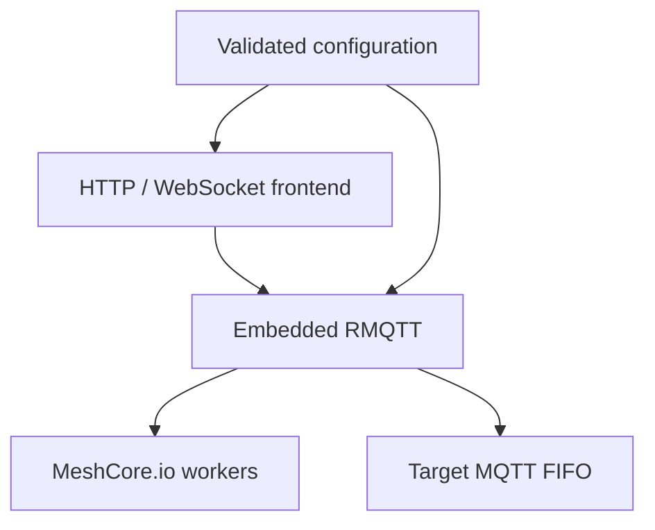

# Broker source

The crate runs one stateless process that embeds RMQTT and composes five
responsibility-focused modules. Runtime state—including sessions, retained
messages, observer ownership, queues, and counters—exists only in memory.

## Module map

| Module | Responsibility |
| --- | --- |
| [`config/`](config/) | Discovers, parses, overrides, and validates deployment configuration. |
| [`mqtt/`](mqtt/) | Authenticates clients, enforces MQTT policy, and adapts those decisions to RMQTT. |
| [`meshcore_io/`](meshcore_io/) | Verifies MeshCore ADVERT ingress and performs signed, retry-aware HTTP uploads. |
| [`target_mqtt/`](target_mqtt/) | Forwards selected telemetry to the optional external MQTT broker. |
| [`frontend/`](frontend/) | Serves `/status` and proxies MQTT-over-WebSocket to the embedded broker. |

## Crate entry points

- [`lib.rs`](lib.rs) exposes the modules used by the binary and integration
  tests.
- [`main.rs`](main.rs) composes configuration, RMQTT, integrations, the shared
  listener, healthcheck mode, and bounded shutdown.

See the [project README](../README.md) for deployment and operation, and
[`AGENTS.md`](AGENTS.md) for source-wide maintenance rules.
