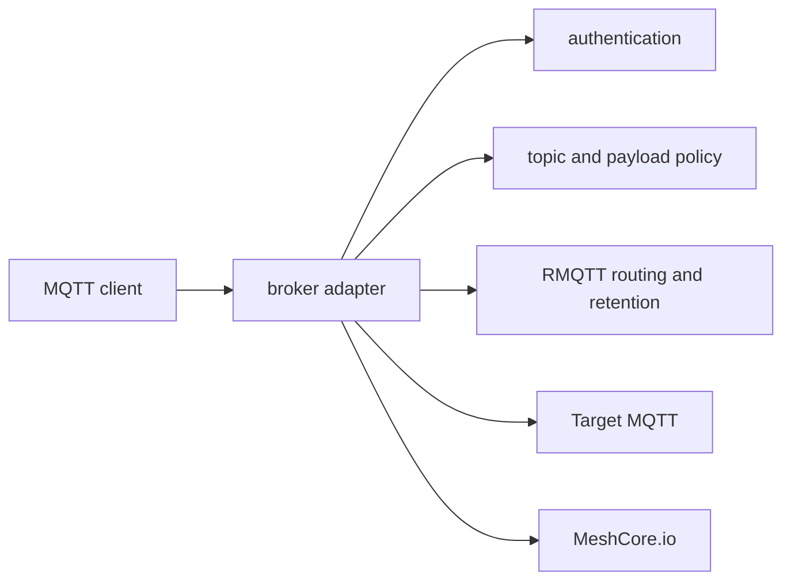

# MQTT

This directory contains the broker's MQTT security and runtime layers. The
layers are intentionally separated so pure authentication and authorization
rules can be tested without RMQTT session internals.

## Submodules

| Module | Responsibility |
| --- | --- |
| [`auth/`](auth/) | Observer JWTs, subscriber credentials and limits, and observer takeover ownership. |
| [`policy/`](policy/) | Pure topic parsing plus publish, subscribe, routing, and delivery decisions. |
| [`broker/`](broker/) | RMQTT hooks, routing adapter, retained storage, heartbeat, and status freshness. |
| [`errors.rs`](errors.rs) | Stable `AUTH_*` and `PUBLISH_*` errors and bounded observer notification JSON. |

## External contract

- Observers authenticate as `v1_<64-hex-public-key>`.
- Owned publishes use `meshcore/<IATA>/<PUBLIC_KEY>/<subtopic>`.
- MQTT `RETAIN` controls in-memory retained storage exactly as received.
- ADMIN, FULL_ACCESS, and LIMITED subscribers receive different topic and
  payload views.
- Broker-owned `/error`, private serial/internal routes, and `$SYS` remain
  protected.

See the [project README](../../README.md) for the complete wire behavior and
[`AGENTS.md`](AGENTS.md) for cross-layer maintenance rules.
